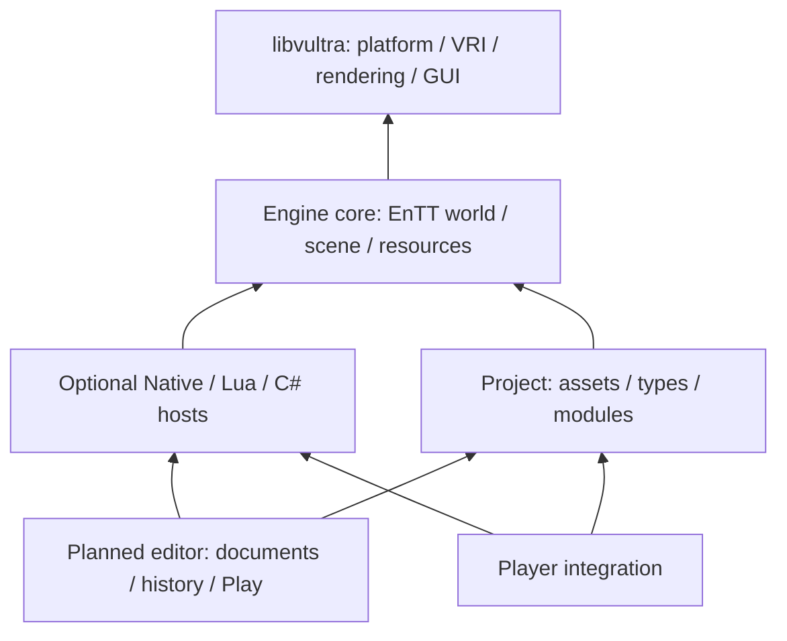
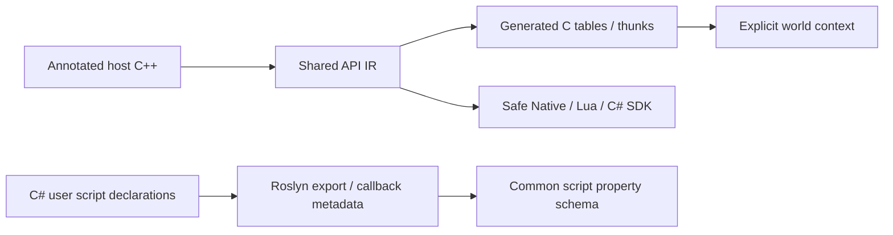

# Architecture

Vultra is a C++23 engine built on libvultra. The engine owns worlds, scene/resource authoring, project data and
script lifecycle. The library supplies platform, graphics, asset data and optional GUI services. A CPU world
requires no GPU, window, editor or language VM. [BUILD.md](../BUILD.md) lists the current targets;
[roadmap.md](roadmap.md) separates implementation from planned editor and delivery work.

## Owners and dependency direction



| Owner | State and lifetime |
| --- | --- |
| Project | Asset identity/dependencies, type catalog and loaded type modules. Install registrations explicitly and retire modules after all users. |
| World | EnTT registry, live identities/hierarchy/components, resources, clock/input and behavior bindings. |
| ScriptHost | Language instances, provider code, reload groups and callback/property borrows for one world. |
| Document, planned | Authored scene/resource data, revision, selection and undo/redo. Play receives a separate world. |
| View | Camera, output targets/history, picking and input ownership. A world does not own a window. |

Registries belong to these owners. No global service locator, plugin registry or second rendering abstraction is
introduced. `vultra_features` adds capabilities and derives the library requirements; `world` excludes graphics,
UI, import/compiler packages and language hosts. CPU import, GPU preparation and rendering are separate additions.

## World and execution

SceneTree owns authoritative EnTT identity, hierarchy, lifecycle and transforms. Attached Node facades hold a
world/entity locator; detached subtrees own staging values transferred on attachment. Runtime-only entities and
custom components need no Node wrapper. There is no per-frame Node-to-ECS copy.

Native systems may query components directly and patch supported data in batches, with change notification.
Identity, ownership and structural edits go through world operations. Property setters validate a candidate before
publishing it through `registry.patch`. SceneChanges revisions drive derived render data: transform/light/material
updates reuse geometry; topology/model changes require reimport at a safe GPU completion point.
`scene_import.hpp` is CPU-only; `scene_gpu_sync.hpp` is an optional graphics consumer.

Execution has enter/ready/exit, fixed-step and variable-step phases, pause/process modes and priorities.
Structural changes during callbacks are deferred. Queued-for-deletion owners stop receiving callbacks immediately;
commands publish at the phase boundary. Reentrant execution and direct structural mutation during dispatch fail.
A callback failure stops the world and propagates; pending commands are discarded rather than partially applied.
GUI construction belongs to its GUI callback, never an update callback.

Input follows UI ownership, Node input and reverse-order unhandled input. Events retain event-time modifiers,
pointer positions/deltas and consumption. Deferred edits publish between events. Routing does not start a stopped
world or update its InputMap implicitly. Callback snapshots own numeric/text values; action queries and consumption
require the original live event serial. A stored event cannot consume a later event. Node input-phase switches
are runtime state. Declared inherited callback lists avoid language calls for classes without input handlers.
Project action configuration, registered-type input notifications and owner-scoped signals remain open.

Worlds own named PCG32 RandomStreams. Seed plus case-sensitive UTF-8 stream name selects the sequence; sharing a
name shares advancement. Unrelated names/worlds remain independent. `randomState()` records version-1 algorithm,
seed and stream state; resetting/restoring requires a stopped idle world. Stop/start and code replacement do not
reset streams. Authored scenes omit transient RNG state. This checkpoint is not full simulation resume, and external
C++/Lua/C# RNGs remain the caller's responsibility.

## Identity, resources and JSON

| Identity | Meaning | Persistence |
| --- | --- | --- |
| AssetId | Project source identity independent of path. | Saved in asset/module references. |
| ResourceId | Mutable authored resource within a scene. | Saved as a local resource ID. |
| ObjectId | Live object in one world. | Never saved; retired IDs remain invalid. |
| EnTT entity, GPU RID, graph handle | Internal runtime/storage identity. | Never saved in scenes or projects. |

Scenes use UTF-8 JSON. All own file, schema and ABI versions remain **1** before release. Breaking changes update
readers, writers, generated bindings and fixtures together; no migrations or compatibility readers.
The [project](../resources/research.vproject) and [scene](../resources/scenes/research.vscene) fixtures show the
current shape. Node records require `components: [{type, data}]`, empty when unused. Inline resources store
`{id, type, data}` and optional `source_asset` provenance.

Loading creates nodes/resources, fills values, resolves typed forward references, then constructs additional
components and validates before activation. Runtime ObjectIds regenerate. Resource IDs are unique in a world;
several resources may share source provenance. Local resource references never fall back to asset lookup.
`duplicateResource()` creates new ResourceId/ObjectId values and copies editable state/provenance; references to
other resources stay shared, so duplication is shallow. Imported ModelResource has metadata but is not an inline
factory. Standalone resource documents and external resource cache policy remain open.

Nested PackedScene/overrides are planned: distinguish parent, authoring owner and reference; remap definition-local
node/resource IDs per instance. Two instances of a template must resolve to different live objects. Sparse overrides
use stable identities rather than child indices or labels. Complete this contract before history stores topology
and reference edits. Loading errors must preserve the previous document, not publish a partial world.

## Properties, reflection and C ABI

PropertySchema owns names, types, defaults, flags, enum/reference/array constraints and Inspector hints.
PropertyInfo adds semantic native accessors. SceneTypeCatalog owns explicit type/component registration records;
worlds borrow them. Component descriptors inspect authoritative ECS storage without exposing raw hierarchy slots
or derived transforms. Metadata does not authorize arbitrary byte writes or bypass setter validation.

One libclang frontend parses annotated C++ into the shared IR. The engine's `source/api/codegen.json` selects its
inputs and checked-in outputs. Generated C tables/property descriptions serve the same objects in all languages.
Shader layout comes from Slang reflection, separately. Ordinary builds need no libclang.



Safe SDK generation is incomplete: native member dispatch and host wrappers remain partly handwritten. The next
gate is one annotated property/method producing all applicable SDK access without per-member emitter branches.
The IR must carry type/base/member roles, public names, layouts, context, phase/thread, ownership and source errors.
Roslyn generates user-script exports/accessors, not the engine SDK. C++26 reflection is not a second production path.

The C boundary passes fixed-width IDs/PODs, pointer/length UTF-8 and callback-scoped opaque borrows. It passes no
C++ classes/STL, exceptions or ImGui types. Tables check version 1, exact size and domain signature/POD fingerprints;
same size alone is insufficient. Rebuild hosts/extensions together after a break. Allocations are released by
their owner; foreign/stale/wrong-kind IDs fail before use. Use explicit math PODs and semantic conversion rather
than assuming GLM/System.Numerics binary compatibility.

## Native extensions and scripting

NativeExtension registers Node, Resource and component code through the generated type domain. Dynamic modules
use the header-only C-facing SDK and never link a second engine core. ProjectTypes installs the project's ordered
`extensions` asset IDs before scene loading. Registration ends after initialization. Worlds, catalog copies,
detached instances, pending commands and EnTT pools must retire before module unload; derived modules retire before
bases. Keep AssetSource alive through teardown. Registered-type hot reload while borrowed is unsupported.

C++ scripts instead use the script adapter/entry macro and ordinary C++ inheritance inside their module.
NativeScriptProvider owns their class providers. Lua class tables and safe C# classes expose the same schema,
object references and lifecycle. The optional C# host targets .NET 10; unsafe interop stays inside the host.
Absent GUI domains remain unavailable and GUI drawing requires a live GUI callback frame.

ScriptClassInfo describes exports and ancestry independently of native ClassDB types. Native `scriptProperty`
records, Lua `exports` and C# `[Export]` support primitives, enums, numeric vectors/matrices, homogeneous arrays
and typed Node/Resource references. Export names cannot shadow inherited/native fields. Reference UUIDs resolve
in the receiving world; stale ObjectIds cannot revive when a new object reuses an authored UUID.

A Lua class can extend a class returned by `require`:

```lua
local Base = require("actors.mover")
local Ship = { class_name = "Ship", extends = Base,
    exports = { boost = { kind = "float", default = 2 } } }
function Ship:_process(delta)
    Base._process(self, delta)
end
return Ship
```

C# scripts import `Vultra.Scripting.props` and use partial classes. Roslyn generates identity, callbacks, export
schemas and private/inherited field access. Invalid/readonly/static/init-only exports and missing partial classes
produce compiler errors. Default values come from new instances before authored overrides. Dynamic loading and
transient-field reload still use reflection; source generation does not establish AOT shipping.

### Attachments and replacement

Project `scripts` records name module asset IDs/languages. A Node optionally stores a SceneScript configuration:

```json
{"script":{"module":"11111111-1111-4111-8111-111111111111","class":"Motion","exports":{"speed":3.0}}}
```

Configuration contains no VM or callbacks and can load/save without code. `ScriptHost::addScene()` resolves
modules through the borrowed project; direct C++ callers can supply ScriptAttachment values without a project.
Construct all instances, resolve prospective references and apply exports before publishing and Ready. Ordinary
field edits do not rewrite authored exports; stopped-world `captureExports()` explicitly records non-default
serializable values. Changing a bound module/class requires detaching its behavior first.

Reload stages dependency/ancestry/reference-connected sources and reverse users together. Validate candidate
schemas, references, dependencies and source hashes before publication. Failed staging preserves live callbacks,
metadata and values; unrelated groups stay independent. Activation failure after commit stops the world and
propagates distinctly. Instances and borrowed callbacks retire before their provider code. Arbitrary constructors,
setters and external side effects are not transactional.

Each host lazily owns one Lua VM/API/require cache; instances have isolated environment/export tables. Initialization
`require` dependencies participate in reload. Failure restores registry-backed cache entries and the dependency
graph; it cannot undo changes inside shared tables/globals/package paths. Native/custom loaders and newly introduced
callback-time imports have no general reload contract. Finalizers receive no scene/UI frame during VM closure.

Managed collectible assembly groups own code leases independently of scene objects. Dependencies share identity
within a group; unrelated same-name modules remain isolated. Clear instances/delegates/wrappers before releasing
the final lease and verify actual GC unload. Successful replacement alone does not prove unloadability.

## Editor, Player and platforms

Native retained GUI and editor document operations are planned. Documents own revision, selection and undo;
controls report begin/change/commit/cancel. Dragging updates immediately and commits one history entry. Play owns
a separate world; stopping it never writes simulation state back into the authored document.
GUI, CLI and a later optional MCP/voice adapter call the same checked commands. Context/identity/revision checks,
owning-thread execution and structured outcomes precede mutation. Reconcile unresolved requests before retrying;
a timed-out request may already have committed. Captures identify the revision actually rendered.
No AI service is required for ordinary editing or scripting.

Desktop and Web editor hosts take priority. Android/iOS/iPadOS initially require compile/link gates, with touch,
IME, persistence and tablet layouts later. Share documents/commands/components while allowing different interaction
flows. Immutable embedded VPK resources remain distinct from writable project storage. A streamed native preview
does not establish Web execution. xtool is a candidate Apple build/sign tool, not a graphics host.

Player/export integration is incomplete. The base target is one EXE with embedded VPK and no editor/importer/compiler
at runtime; system graphics/display/libc remain dependencies. Static Lua may read packed source; native/.NET modules
need explicit runtime/sidecar manifests. Engine shader bootstrap still materializes files. Neither Linux static
libraries nor managed generation prove fully static or AOT delivery. Research policy stays outside the base Player.

## Design references

These sources guide responsibility boundaries; they do not establish feature or runtime parity.

- [Godot native API](https://github.com/godotengine/godot/blob/876b290332ec6f2e6d173d08162a02aa7e6ca46d/core/extension/extension_api_dump.cpp) and [C# generator](https://github.com/godotengine/godot/blob/876b290332ec6f2e6d173d08162a02aa7e6ca46d/modules/mono/editor/bindings_generator.cpp): explicit exported metadata and generated SDKs, separately from user-script exports.
- [Bevy reflection](https://github.com/bevyengine/bevy/blob/566358363126dd69f6e457e47f306c68f8041d2a/crates/bevy_reflect/src/type_registry.rs): additive capabilities and reflected components; EnTT remains our runtime authority.
- [Flax bindings](https://github.com/FlaxEngine/FlaxEngine/blob/57fe03308a05868f07cda77bae8acf553dcb9bf8/Source/Tools/Flax.Build/Bindings/BindingsGenerator.cs): annotated type/member model and emitters. Implement independently; its source is [EULA-governed](https://github.com/FlaxEngine/FlaxEngine/blob/57fe03308a05868f07cda77bae8acf553dcb9bf8/LICENSE.md).
- [Mainframe registration generator](https://github.com/Mainframe-Games/mainframe-engine/blob/2fcdb6c4f4d1760f0aab60bd1f687574b252f293/MainframeEngine.Generators/RegistrationEmitter.cs): typed access/codecs shared by authoring and Inspector; retain context-owned registration and version-1 JSON here.
- [OpenEngine API model](https://github.com/Game-Crafters-Guild/OpenEngine/blob/583571412ba1959a6d74369ad70e7cc2d242b8f5/Tools/ComponentScanner/ApiModel.h): resolved binding metadata and tested signatures. Its browser editor informs shared documents with host-specific entry points.
- [.NET assembly identity](https://learn.microsoft.com/en-us/dotnet/core/dependency-loading/understanding-assemblyloadcontext) and [unloadability](https://learn.microsoft.com/en-us/dotnet/standard/assembly/unloadability), plus [Lua environments](https://www.lua.org/manual/5.4/manual.html#2.2): host ownership and reload limits.
